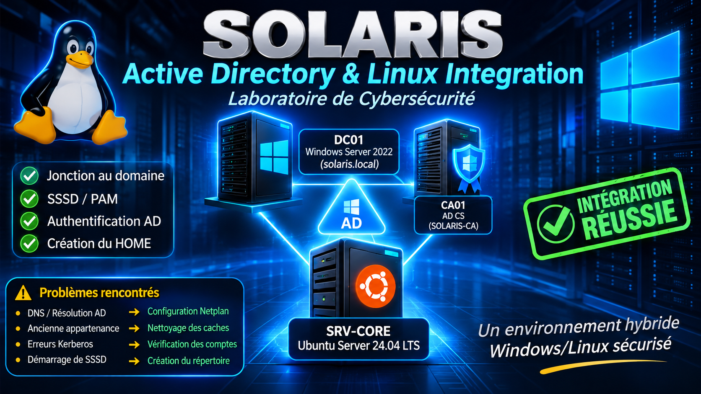

# SOLARIS -Intégration d'un serveur Ubuntu à Active Directory


Arnold Edwin / Hackthus

## 1. Présentation du projet

### 1.1. Objectif

L'objectif de cette étape du laboratoire SOLARIS est d'intégrer un serveur Ubuntu Server 24.04.4 LTS dans un domaine Microsoft Active Directory existant.

Cette intégration permet de centraliser la gestion des identités et des authentifications au sein de l'infrastructure Windows/Linux.

Les utilisateurs du domaine peuvent ainsi s'authentifier sur le serveur Ubuntu avec leurs identifiants Active Directory, sans avoir besoin de créer des comptes Linux locaux individuels.

### 1.2. Environnement technique

| Composant | Configuration |
| --- | --- |
| Hyperviseur | VMware Workstation |
| Contrôleur de domaine | DC01 |
| Système DC01 | Windows Server 2022 |
| Adresse IP DC01 | 192.168.237.162 |
| Domaine AD | solaris.local |
| Nom NetBIOS | SOLARIS |
| Serveur Linux | SRV-CORE |
| Système Linux | Ubuntu Server 24.04.4 LTS |
| Adresse IP Linux | 192.168.237.129 |
| Interface réseau | ens33 |
| Utilisateur Linux local | adminsolaris |
| Utilisateur AD de test | linux.test |
| Service d'intégration | SSSD |
| Gestion du domaine | realmd / adcli |
| Authentification | Kerberos |
| Gestion des sessions | PAM |

### 1.3. Architecture

L'infrastructure repose sur trois serveurs principaux :

- **DC01** : contrôleur de domaine Active Directory et serveur DNS.
- **CA01** : autorité de certification Enterprise Root CA, nommée SOLARIS-CA.
- **SRV-CORE** : serveur Ubuntu intégré au domaine Active Directory.

## 2. Préparation du serveur Ubuntu

### 2.1. Vérification du système

```
cat /etc/os-release
```


```
hostnamectl
```


```
ip -br addr
```


```
resolvectl status
```


### 2.2. Configuration du nom d'hôte

Le nom complet du serveur doit être :

`srv-core.solaris.local`

Configuration :

```
sudo hostnamectl set-hostname srv-core.solaris.local
```

Modification du fichier hosts :

```
sudo vim /etc/hosts
```

Configuration :

```
127.0.0.1 localhost
127.0.1.1 srv-core.solaris.local srv-core
```


Vérification :

```
hostname
hostname -f
```

Résultat  :


## 3. Configuration DNS

Le serveur Ubuntu doit utiliser le serveur DNS du contrôleur de domaine pour résoudre les enregistrements Active Directory.

### 3.1. Identification du DNS

Le DNS du domaine est hébergé sur DC01 :

`192.168.237.162`

### 3.2. Configuration Netplan

Fichier :

```
sudo vim /etc/netplan/50-cloud-init.yaml
```

Configuration utilisée :

```
network:
  version: 2
  ethernets:
    ens33:
      dhcp4: true
      dhcp4-overrides:
        use-dns: false
      nameservers:
        addresses:
          - 192.168.237.162
        search:
          - solaris.local
```


Cette option :

```
use-dns: false
```

empêche DHCP d'ajouter le DNS VMware `192.168.237.2`.

Sécurisation du fichier :

```
sudo chmod 600 /etc/netplan/50-cloud-init.yaml
```

Application :

```
sudo netplan generate
sudo netplan try
```

### 3.3. Vérification DNS

```
resolvectl status
```


Vérification de la résolution du contrôleur de domaine :

```
nslookup dc01.solaris.local
```

Résultat  :


```
Address: 192.168.237.162
```

Vérification des enregistrements LDAP :

```
nslookup -type=SRV _ldap._tcp.solaris.local 192.168.237.162
```


Vérification des enregistrements Kerberos :

```
nslookup -type=SRV _kerberos._tcp.solaris.local 192.168.237.162
```


Ces enregistrements permettent notamment aux clients de découvrir les services Active Directory.

## 4. Installation des composants nécessaires

Installation des paquets :

```
sudo apt update

sudo apt install -y realmd sssd sssd-ad sssd-tools \
libnss-sss libpam-sss adcli samba-common-bin \
oddjob oddjob-mkhomedir krb5-user
```

### Rôle des composants

| Paquet | Fonction |
| --- | --- |
| realmd | Découverte et intégration aux domaines |
| sssd | Gestion des identités et authentifications |
| sssd-ad | Intégration spécifique à Active Directory |
| sssd-tools | Outils de diagnostic SSSD |
| libnss-sss | Résolution des identités AD via NSS |
| libpam-sss | Authentification via PAM |
| adcli | Gestion des comptes machines AD |
| krb5-user | Outils d'authentification Kerberos |
| samba-common-bin | Outils complémentaires Samba |

## 5. Découverte du domaine Active Directory

Vérification de la découverte du domaine :

```
realm discover -v solaris.local
```


Vérification de la découverte AD avec adcli :

```
sudo adcli info solaris.local
```


Le résultat doit notamment identifier :

```
domain-name = solaris.local
domain-short = SOLARIS
domain-controller = DC01.solaris.local
domain-controller-usable = yes
```

Cette étape confirme que le serveur Linux peut découvrir le domaine et son contrôleur.

## 6. Jonction du serveur Ubuntu au domaine

Commande utilisée :

```
sudo realm join --verbose --user=Administrator \
--computer-name=SRV-CORE solaris.local
```


Le mot de passe du compte d'administration du domaine est demandé dans le terminal.

Si tous ce passe bien a la fin on va avoir ce message 


Après l'enrôlement, vérifier :

```
realm list
```


Puis :

```
sudo adcli testjoin --domain=solaris.local
```


Résultat obtenu :

```
Successfully validated join to domain solaris.local
```

Ce résultat confirme que le compte machine peut s'authentifier auprès du domaine.

## 7. Configuration et fonctionnement de SSSD

SSSD assure la communication entre les services Linux et Active Directory.

### 7.1. Vérification du service

```
sudo systemctl status sssd
```


### 7.2. Vérification de l'état du domaine

```
sudo sssctl domain-status solaris.local
```


Résultat obtenu :

```
Online status: Online

Active servers:
AD Global Catalog: dc01.solaris.local
AD Domain Controller: dc01.solaris.local
```

### 7.3. Vérification de la configuration

```
sudo sssctl config-check
```


Résultat obtenu :

```
Issues identified by validators: 0
```

## 8. Configuration PAM et création automatique des répertoires personnels

Activation de la création automatique du répertoire personnel :

```
sudo pam-auth-update --enable mkhomedir
```

Vérification :

```
grep -n pam_mkhomedir /etc/pam.d/common-session
```


Résultat obtenu :

```
31:session optional pam_mkhomedir.so
```

Cette fonctionnalité permet de créer automatiquement le répertoire personnel d'un utilisateur AD lors de sa première connexion.

## 9. Création d'un utilisateur de test dans Active Directory

Sur DC01, ouverture de PowerShell en administrateur.

Création du compte :

```
New-ADUser `
  -Name "Linux Test" `
  -GivenName "Linux" `
  -Surname "Test" `
  -SamAccountName "linux.test" `
  -UserPrincipalName "linux.test@solaris.local" `
  -Path "CN=Users,DC=solaris,DC=local" `
  -AccountPassword (Read-Host "Mot de passe" -AsSecureString) `
  -Enabled $true `
  -ChangePasswordAtLogon $false
```


Vérification :

```
Get-ADUser linux.test -Properties Enabled,UserPrincipalName |
Format-List Name,SamAccountName,UserPrincipalName,Enabled
```


Résultat :

```
Name              : Linux Test
SamAccountName    : linux.test
UserPrincipalName : linux.test@solaris.local
Enabled           : True
```

## 10. Tests d'intégration depuis Ubuntu

### 10.1. Résolution de l'utilisateur AD

```
id 'linux.test@solaris.local'
```


Résultat obtenu :

```
uid=1361401105(linux.test@solaris.local)
gid=1361400513(utilisateurs du domaine@solaris.local)
groups=1361400513(utilisateurs du domaine@solaris.local)
```

### 10.2. Récupération des informations du compte

```
getent passwd 'linux.test@solaris.local'
```


Résultat obtenu :

```
linux.test@solaris.local:*:1361401105:1361400513:Linux Test:/home/linux.test@solaris.local:/bin/bash
```

### 10.3. Authentification Kerberos

```
kinit linux.test@SOLARIS.LOCAL
```

Saisie du mot de passe du compte AD.

Vérification du ticket :

```
klist
```


### 10.4. Test de connexion utilisateur

```
su - 'linux.test@solaris.local'
```

Lors de la première connexion, le système affiche :

```
Creating directory '/home/linux.test@solaris.local'.
```


Ce message confirme la création automatique du répertoire personnel.

## 11. Incidents rencontrés et solutions appliquées

Cette partie recense les difficultés rencontrées pendant l'intégration et les solutions utilisées.

### Incident 1 - Échec de découverte du domaine

**Symptôme :**


```
adcli: couldn't discover domain: solaris.local
```

La commande `adcli info solaris.local` ne parvenait pas à découvrir correctement le domaine.

**Cause identifiée :**

Le serveur Ubuntu utilisait initialement le DNS VMware :

`192.168.237.2`

Au lieu du DNS Active Directory :

`192.168.237.162`

**Solution :**

Modification de Netplan afin d'utiliser le DNS de DC01 et d'empêcher DHCP d'ajouter le DNS VMware.

```
dhcp4-overrides:
  use-dns: false
nameservers:
  addresses:
    - 192.168.237.162
  search:
    - solaris.local
```

Puis :

```
sudo netplan generate
sudo netplan try
```

**Validation :**

```
nslookup dc01.solaris.local
sudo adcli info solaris.local
```

Les deux commandes ont ensuite fonctionné.

### Incident 2 - Ancienne appartenance au domaine détectée

**Symptôme :**

```
realm: Already joined to this domain
```

Pourtant, le compte machine `SRV-CORE` était absent d'Active Directory.

**Diagnostic :**

Sur DC01 :

```
Get-ADComputer -Filter * -Properties DNSHostName |
Select-Object Name,DNSHostName
```

Seuls DC01 et CA01 apparaissaient.

Sur Ubuntu :

```
sudo adcli testjoin --domain=solaris.local
```

Résultat :

```
Client 'SRV-CORE$@SOLARIS.LOCAL' not found in Kerberos database
```

L'ancien état local ne correspondait donc pas à un compte machine valide dans AD.

**Solution :**

Sauvegarde des fichiers :

```
sudo mkdir -p /root/backup-ad-old

sudo cp -a /etc/krb5.keytab /root/backup-ad-old/
sudo cp -a /etc/sssd/sssd.conf /root/backup-ad-old/
sudo cp -a /etc/krb5.conf /root/backup-ad-old/
```

Vérification :

```
sudo ls -l /root/backup-ad-old/
```

Puis retrait de l'ancienne configuration d'appartenance :

```
sudo realm leave solaris.local
```

Vérification :

```
realm list
```

La commande ne retournait alors plus de domaine configuré.

### Incident 3 — Ancien compte machine Kerberos invalide

**Symptôme :**

```
Client 'SRV-CORE$@SOLARIS.LOCAL' not found in Kerberos database
```

**Cause identifiée :**

L'ancien fichier `/etc/krb5.keytab` contenait des clés associées à un compte machine qui n'existait plus dans Active Directory.

**Solution :**

Après sauvegarde des fichiers, arrêt de SSSD :

```
sudo systemctl stop sssd
```

Mise de côté de l'ancien cache :

```
sudo mv /var/lib/sss/db /var/lib/sss/db.old
```

Suppression de l'ancien keytab :

```
sudo rm -f /etc/krb5.keytab
```

Vérification du nom d'hôte :

```
hostname -f
```

Puis nouvelle tentative de jonction au domaine.

### Incident 4 - Erreur Kerberos pendant la jonction

**Symptôme :**

```
Couldn't authenticate as: Administrator@SOLARIS.LOCAL:
Client 'Administrator@SOLARIS.LOCAL' not found in Kerberos database
```

**Interprétation :**

L'authentification Kerberos du principal indiqué n'a pas abouti. Le nom du compte utilisé doit correspondre à un principal reconnu par le domaine.

Dans cet environnement, le compte administrateur apparaît sous le nom français `Administrateur` lors de la résolution NSS.

**Vérifications recommandées :**

Sur DC01 :

```
Get-ADUser -Identity Administrator -Properties SamAccountName,UserPrincipalName,Enabled
```

Sur Ubuntu :

```
sudo adcli info solaris.local
```

**Résultat final :**

L'enrôlement de la machine a finalement été confirmé par le message :

```
Successfully enrolled machine in realm
```

Puis validé avec :

```
sudo adcli testjoin --domain=solaris.local
```

Résultat :

```
Successfully validated join to domain solaris.local
```

### Incident 5 - Échec du démarrage de SSSD

**Symptôme :**

```
SSSD couldn't load the configuration database [5]:
Input/output error
```

**Diagnostic :**

Vérification de la configuration :

```
sudo sssctl config-check
```

Résultat :

```
Issues identified by validators: 0
```

Vérification des répertoires :

```
sudo ls -ld /etc/sssd /var/lib/sss /var/lib/sss/db
```

Le répertoire `/var/lib/sss/db` était absent à la suite du déplacement de l'ancien cache.

**Solution appliquée :**

Recréation du répertoire :

```
sudo mkdir -p /var/lib/sss/db
```

Attribution des permissions :

```
sudo chown root:root /var/lib/sss/db
sudo chmod 700 /var/lib/sss/db
```

Redémarrage du service :

```
sudo systemctl restart sssd
```

**Résultat :**

```
Active: active (running)
```

SSSD a démarré correctement.

### Incident 6 - Confusion sur le nom du compte administrateur

**Symptôme :**

La résolution de `Administrator@solaris.local` ne correspondait pas au nom du compte visible dans l'environnement.

**Cause :**

Le compte administrateur du domaine est nommé `Administrateur` dans cette installation.

**Solution :**

Utiliser le nom effectivement retourné par Active Directory :

```
getent passwd 'Administrateur@solaris.local'
```

Cette commande a permis de récupérer correctement l'identité du compte.

## 12. Vérifications finales

Les contrôles suivants permettent de vérifier l'état de l'intégration.

| Contrôle | Commande | Résultat |
| --- | --- | --- |
| Nom FQDN | `hostname -f` | Validé |
| DNS AD | `nslookup dc01.solaris.local` | Validé |
| Découverte du domaine | `adcli info solaris.local` | Validé |
| Jonction AD | `adcli testjoin --domain=solaris.local` | Validé |
| État SSSD | `systemctl status sssd` | Actif |
| État du domaine | `sssctl domain-status solaris.local` | Online |
| Configuration SSSD | `sssctl config-check` | Aucune erreur |
| Résolution utilisateur | `id 'linux.test@solaris.local'` | Validée |
| Résolution NSS | `getent passwd 'linux.test@solaris.local'` | Validée |
| Authentification | `kinit linux.test@SOLARIS.LOCAL` | Testée |
| Création du HOME | Première connexion avec `su -` | Validée |

## 13. Résultat et conclusion

L'intégration du serveur Ubuntu Server 24.04.4 LTS au domaine Active Directory `solaris.local` a été réalisée avec succès.

Le serveur `SRV-CORE` est désormais membre du domaine et utilise les services Active Directory pour la résolution des identités et l'authentification des utilisateurs.

Les tests ont permis de confirmer :

- La communication DNS entre Ubuntu et le contrôleur de domaine.
- La découverte des services Active Directory.
- L'enrôlement du compte machine dans le domaine.
- Le fonctionnement du service SSSD.
- La résolution des comptes et groupes Active Directory.
- L'authentification Kerberos.
- L'authentification d'un utilisateur standard du domaine.
- La création automatique des répertoires personnels avec PAM.

Les différents incidents rencontrés ont également permis de mieux comprendre les dépendances entre DNS, Kerberos, realmd, adcli, SSSD et PAM.

Cette intégration constitue une étape importante dans la construction du laboratoire de cybersécurité SOLARIS. Elle permettra notamment de réaliser des scénarios de tests sur les environnements hybrides Windows/Linux, la gestion des identités, les authentifications centralisées et la sécurité des infrastructures Active Directory.

---

**Projet :** SOLARIS - Active Directory & Linux Integration

**Environnement :** VMware Workstation

**Statut :** Intégration terminée et tests fonctionnels validés.

**Prochaine évolution :** intégration d'un serveur SQL Server au domaine, puis réalisation de scénarios de sécurité et d'audit Active Directory et AD CS.